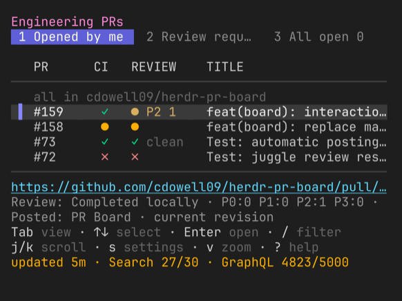
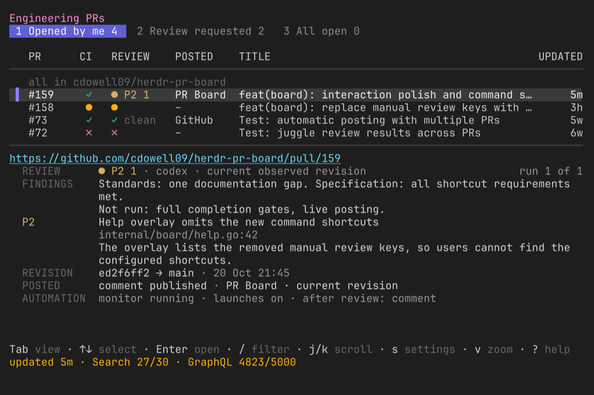
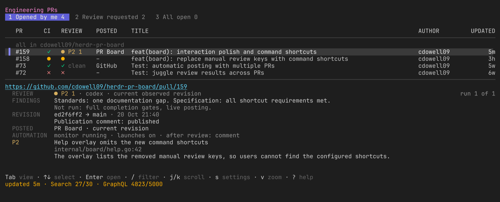

# Board controls and status

The plugin supplies these default views:

- **Opened by me** shows each open PR that your GitHub account created.
- **Review requested** shows each open PR that requests your review.
- **All open** shows each open PR in the configured scopes.

You can add, remove, rename, or move views in `config.toml`.

A view with no pull requests shows text for that view and the next keys:

| View | Text |
| --- | --- |
| **Opened by me** | `You have no open pull requests.` |
| **Review requested** | `No open pull requests wait for your review.` |
| **All open** | `No open pull requests are in the configured scopes.` |
| A view that you add | `No pull requests match "<query>".` |

A default view keeps its text while it keeps the default query and scope.
A default view with a changed query or scope names the query.
Each empty view names `Tab` for the next view, `E` to edit the configuration, and `Ctrl+R` to refresh.
The board omits `Tab` when the configuration has one view.
The text wraps on narrow terminals. No width removes a key.
A short terminal makes the text shorter. Then it shows the keys without the actions.
The filter, loading, and error messages replace this text.

The board shows the URL of the selected PR.

The CI column uses a symbol and a color:

| Symbol | Color | Meaning |
| --- | --- | --- |
| `✓` | Green | All checks passed. |
| `●` | Yellow | One or more checks are pending. |
| `✗` | Red | One or more checks failed. |
| `–` | Dim | The PR has no checks. |
| `?` | Dim | The plugin cannot get the check status. |

The **REVIEW** column shows local PR Board reviews for the current revision.
A completed review with findings shows the finding count for each severity:

```
P0:1 P1:2 P2:0 P3:3
```

The counts are in severity order from P0 to P3. A count of 10 or more shows `+`.
A P0 count above zero is red. A P1 count above zero is yellow. Zero counts are dim.
Every other state uses the CI symbols:

| Symbol | Meaning |
| --- | --- |
| `✓` | The current revision has a completed local review with no findings. |
| `●` | A review is running, queued, waiting for a slot, or awaiting dispatch. |
| `✗` | The current revision has a failed, blocked, or abandoned review. |
| `–` | No local review is active or complete for this revision. |
| `?` | Local review status or the current revision is unavailable. |

Select a PR to read its local reviews in the review region below the URL.
A rule closes the table above the URL, so the table and the region read as two areas.
A line under the URL summarizes the posted reviews.
The region header names the outcome, the reviewer, the revision comparison, and the severity counts.
The findings follow the header.
A terminal with fewer than 24 rows collapses the region to one summary line.
That line shows the exact count for each severity, or `no findings`.
Local status updates each second without GitHub requests.

The **POSTED** column shows submitted reviews from your authenticated GitHub account:

| Label | Meaning |
| --- | --- |
| `GitHub` | Reviews posted outside this PR Board installation. |
| `PR Board` | Reviews matched to this installation's publication records. |
| `Both` | Both sources have submitted reviews. |
| `–` | No submitted reviews were found. |
| `?` | Review history, publication origin, or a publication outcome is uncertain. |

The selected detail shows whether each source has a review on the current head.
Otherwise, it identifies older reviews or an unknown revision.
A newer commit does not inherit a completed local review.
Draft reviews and ordinary PR conversation comments do not count as submitted reviews.
Dismissed reviews still count as posts. The column does not represent approval status.
`GitHub` identifies the publication source. It does not prove that a human wrote the review.
A review started with `--review` is still a PR Board review.
Press `v` to zoom the review region for previous runs and publication diagnostics.
GitHub review observations follow the normal refresh interval and cache.

## Controls

| Key | Action |
| --- | --- |
| Left click a view | Select the view. |
| Left click a PR | Select the PR. A click on the selected PR opens it in a browser. |
| Left click the URL | Open the PR in a browser. |
| Left click a footer key | Do the action of that key. |
| Mouse wheel | Over the table, move through the PR list. Over the review region, scroll the region. |
| `1`–`9` | Select a view. |
| `Tab`, `Shift+Tab`, `h`, `l`, `←`, `→` | Select the next or previous view. |
| `↑`, `↓` | Select a PR. |
| `Home` | Select the first PR. |
| `End` | Select the last PR. |
| `j`, `k` | Scroll the review region by one line. |
| `g`, `G` | Scroll to the start or the end of the review region. |
| `PgUp`, `PgDn` | Scroll the review region by one page. |
| `/` | Start filter input. |
| `↑`, `↓` | During filter input, select a PR. |
| `Enter` | Keep the filter and finish filter input. |
| `Backspace` | Remove the last filter character. When the filter is empty, finish filter input. |
| `Ctrl+U`, `Esc` | Clear the filter. |
| `E` | Edit the active configuration. |
| `v` | Zoom the review region to the full height. |
| `t`, `s`, `c`, `a`, `x` | Act on the selected PR's reviews. See [review region](reviews.md#use-the-review-region). |
| A command shortcut key | Run the command shortcut for the selected PR. See [command shortcuts](#command-shortcuts). |
| `Ctrl+R` | Refresh the active view. |
| `R` | Refresh all views. |
| `Enter`, `o` | Open the selected PR in a browser. |
| `?` | Open or close the keyboard help. |
| `q`, `Ctrl+C` | Close the board. |

The board sorts PRs by update time, with the most recent first.
The filter matches repository names, titles, authors, and PR numbers.
It also matches the REVIEW and CI cells and their state names.
For example, `/p0:1` finds a review with one P0 finding.
`/failure` finds failed CI.
The filter ignores letter case and makes no GitHub requests.
One filter applies to all views.
A refresh keeps the selection on the same PR while the PR stays in the view.

Press `E` to edit the active configuration while the board runs.
The board uses `$VISUAL`, then `$EDITOR`.
The fallback editor is Notepad on Windows and `vi` on macOS and Linux.
The footer names the editor before it starts. For example: `Opening config in vi. Set $VISUAL or $EDITOR to change.`
The board also writes this line to the terminal that the editor uses.
It validates the file after the editor exits. It reloads valid changes and refreshes all views.
It keeps the previous configuration when the editor or validation fails.

The board reports browser failures at the bottom of the screen.
The selected URL stays visible for manual copying.

The footer shows the most used controls. On narrow terminals, the pairs wrap.
A short pane shows the keys without the actions.
Click a footer key to do the action of that key. The click is the same as the key press.
A footer entry with two keys, such as `j/k`, does not respond to a click.

Press `?` for the keyboard help.
The help lists every board control, every review region control, and every command shortcut.
Scroll it with `j`, `k`, `↑`, `↓`, `g`, `G`, `Home`, `End`, or the mouse wheel.
Press `?` or `Esc` to close it.

See [reviews](reviews.md) for review controls, cancellation, and result history.

## Command shortcuts

A command shortcut runs your command for the selected PR in a new Herdr pane.
Add `[[shortcuts]]` tables to `config.toml`. See [command shortcuts](configuration.md#command-shortcuts).
No command shortcut is active by default.

Press the shortcut key on the board or in zoom.
In zoom, the shortcut uses the zoomed PR.
The footer shows each shortcut as its key and name. Click it to run the shortcut.
The shortcut key does not run during filter input or a publication confirmation.

A `tab` shortcut opens a new focused Herdr tab. The tab label is `<name> <owner/repo>#<number>`.
A `split` shortcut splits the board pane to the right and focuses the new pane.
The new pane runs the command under `sh -c`.
After the launch, the footer shows a notice, for example `Pi review → owner/repo#12`.
A launch failure shows a warning in the footer.
The board does not track the new pane. The shortcut does not change the REVIEW column.

## Open the board with a shortcut

Run this command:

```sh
herdr plugin action invoke open --plugin cdowell09.pr-board
```

The action opens a dedicated tab named `PR Board`.
If the tab is open, the action focuses that tab.

You can add this key binding to `~/.config/herdr/config.toml`:

```toml
[[keys.command]]
key = "prefix+shift+b"
type = "plugin_action"
command = "cdowell09.pr-board.open"
description = "open PR board"
```

Reload the Herdr configuration:

```sh
herdr server reload-config
```

The default Herdr prefix is `Ctrl+B`. Press `Ctrl+B`, and then press `Shift+B` to open the board.

The shortcut does not replace `prefix+shift+p`. Herdr uses that shortcut to rename a pane.

## Layouts

The board adapts to the terminal width:

| Terminal width | Layout |
| --- | --- |
| 120 cells or more | All columns. |
| 100–119 cells | All columns with compact repository and author columns. |
| 80–99 cells | No author column. |
| 60–79 cells | No author or updated columns. |
| Fewer than 60 cells | PR, CI, REVIEW, and title columns. |

The REVIEW column keeps 19 cells at every width. The title column absorbs the difference.
Below 100 cells, the title column shows only a few characters.
The title bar shows the plugin version at 80 cells or more.
A narrower terminal omits the version and keeps the configured title.
The selected PR URL stays visible at every width.
A terminal with 24 rows or more shows the review region under the URL.
The table keeps its rows up to half the screen.
The region takes the rest and keeps at least six rows.
A shorter terminal shows the one-line summary under the URL instead.
The summary wraps at the terminal width.
The board truncates column text by terminal cell width.
Emoji, combining characters, and wide glyphs stay aligned.






